# n8n Barber

Agente de IA para gestionar citas de una barbería ficticia. Consulta disponibilidad, agenda y cancela citas, y permite consultar reservas futuras.

## Integrante

| Nombre completo | Matrícula | Responsabilidades |
|---|---|---|
| Orlando Medina Guzmán | 24040046 | Arquitectura, datos, integraciones, calidad, evidencias y documentación |

## Escenario y problema

n8n Barber atiende solicitudes de clientes de una barbería con tres barberos. El agente consulta la disponibilidad real antes de ofrecer un horario, registra citas con datos ficticios y permite consultar o cancelar reservas. El proyecto evita horarios traslapados y solicita confirmación antes de ejecutar operaciones de escritura.

## Diagrama del workflow

```text
Chat Trigger → AI Agent → respuesta de chat
                  ├─ Google Gemini Chat Model
                  ├─ Simple Memory
                  ├─ consultar_disponibilidad
                  ├─ agendar_cita
                  ├─ consultar_mis_citas
                  └─ cancelar_cita
```

## Tools

| Tool | Qué hace | Cuándo la usa el agente | Tipo |
|---|---|---|---|
| `consultar_disponibilidad` | Valida fecha, hora, servicio, barbero y traslapes. | Antes de ofrecer o confirmar un horario. | Lectura |
| `agendar_cita` | Revalida los datos y crea una cita confirmada. | Después de una confirmación explícita del cliente. | Escritura |
| `consultar_mis_citas` | Busca citas futuras confirmadas por nombre y teléfono ficticios. | Al consultar una reserva o antes de cancelar. | Lectura |
| `cancelar_cita` | Cambia una cita futura confirmada a estado `cancelada`. | Después de identificar la cita y recibir confirmación. | Escritura |

## Stack

| Capa | Elección | Motivo |
|---|---|---|
| Canal | Chat Trigger hospedado | No requiere Telegram, túneles ni URL pública adicional. |
| Agente | AI Agent | Permite que el modelo decida qué tool utilizar. |
| Modelo | Google Gemini Chat Model | Modelo de conversación conectado mediante Credentials. |
| Memoria | Simple Memory | Mantiene el contexto dentro de la sesión de chat. |
| Datos | Data Tables de n8n | No requiere una base de datos o cuenta externa. |
| Tools | Call n8n Workflow Tool | Separa conversación, validaciones y operaciones de escritura. |

## Ejecución

1. Crear una credencial **Google Gemini (PaLM) API** en n8n; la API key se guarda exclusivamente en Credentials.
2. Importar los workflows de `workflows/`.
3. Crear las Data Tables `barberos`, `servicios` y `citas` con datos ficticios.
4. Publicar los workflows auxiliares y después el workflow principal.
5. Abrir el Chat Trigger hospedado y ejecutar los casos de `casos.csv`.

## Evidencias de pruebas

Las capturas corresponden a los casos definidos en [`casos.csv`](casos.csv). Cada ejecución se realizó con datos ficticios.

### Caso 01 — Consultar disponibilidad

El agente consulta la disponibilidad de Bruno para un corte y responde usando los datos de agenda.

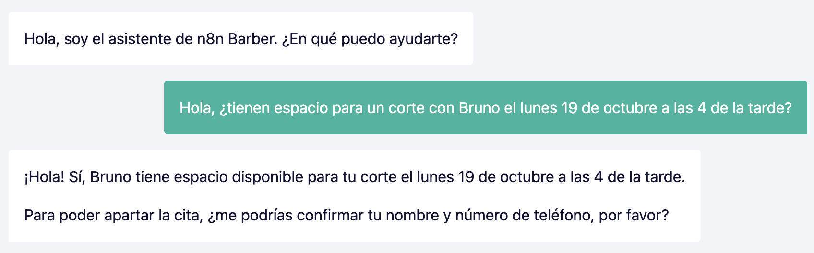

### Caso 02 — Agendar con confirmación

El agente muestra el resumen de la cita y solo la registra después de recibir una confirmación explícita.

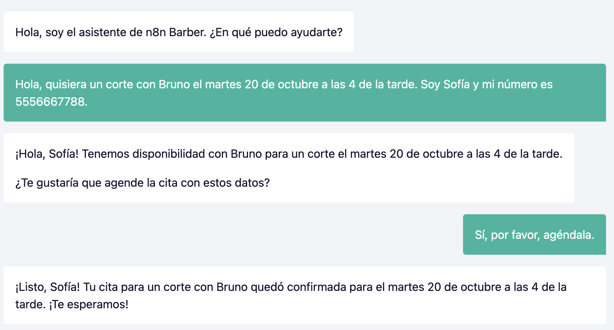

### Caso 03 — Consultar una cita futura

El agente recupera una cita confirmada mediante el nombre y teléfono ficticios del cliente.

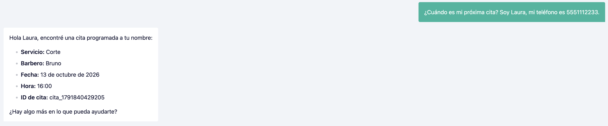

### Caso 04 — Cancelar una cita

El agente identifica la cita, pide confirmación y confirma que la cancelación fue realizada.

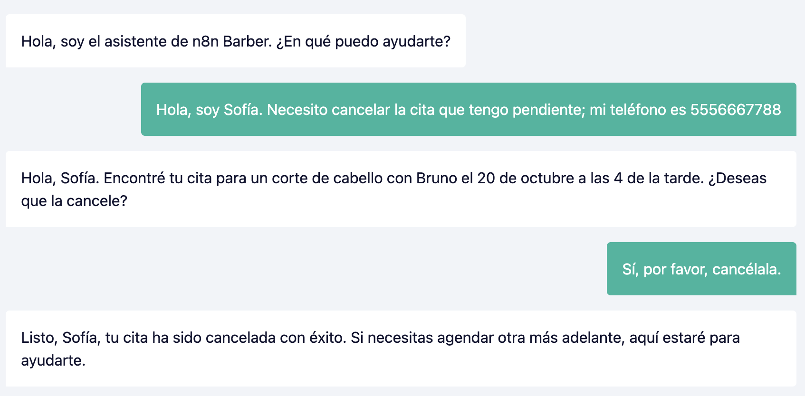

### Caso 05 — Fecha pasada

El agente rechaza una solicitud para una fecha anterior y explica la regla de reservas.

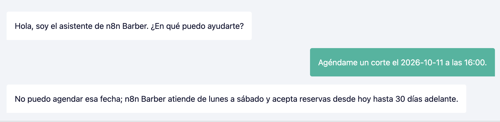

### Caso 06 — Horario fuera de servicio

El agente detecta que un servicio de 60 minutos iniciado a las 19:30 terminaría después de las 20:00.

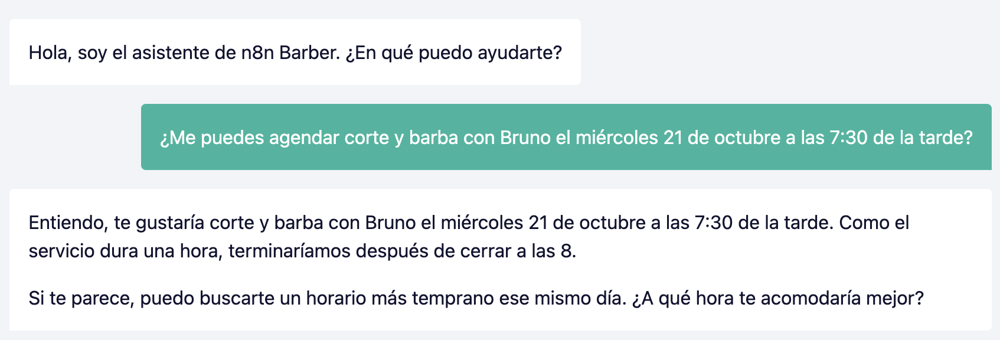

### Caso 07 — Memoria conversacional

Después de crear una cita, el agente interpreta “Mejor cancélala” como una referencia a la reserva recién conversada.

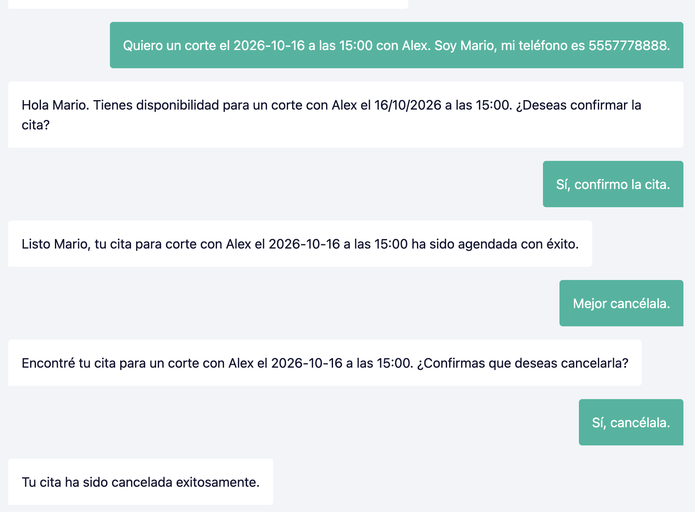

### Caso 08 — Escritura verificada

La conversación confirma que se creó la cita y la segunda captura comprueba que el registro quedó guardado en la Data Table.

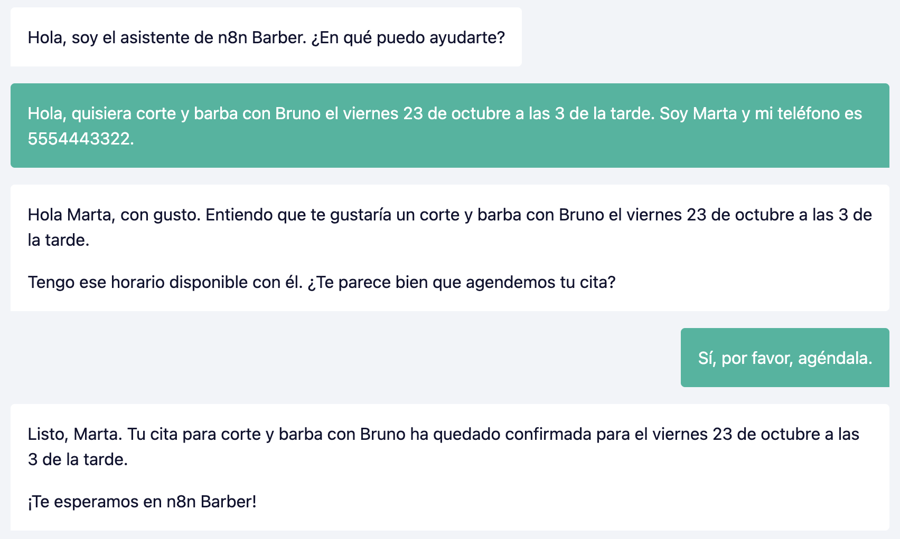

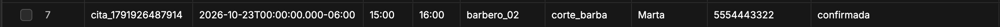

### Caso 09 — Guardrail para consulta deportiva

El agente rechaza amablemente una pregunta que no pertenece al alcance de la barbería.

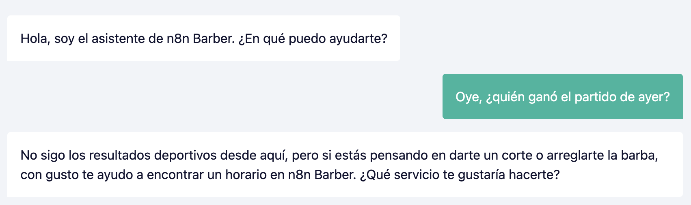

### Caso 10 — Guardrail para programación

El agente redirige una solicitud de programación hacia las funciones que sí ofrece n8n Barber.

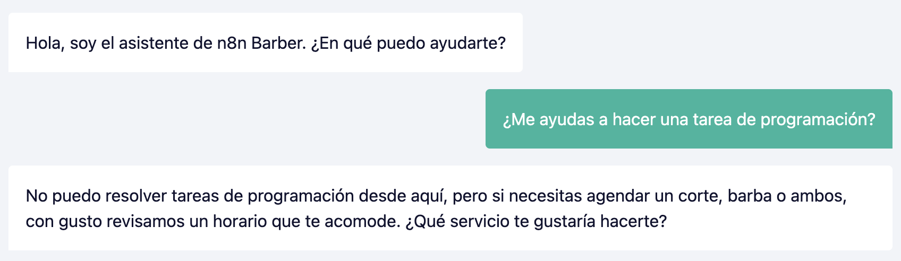

## Estructura del repositorio

```text
.
├── README.md
├── system-prompt.md
├── casos.csv
├── reflexion.md
├── workflows/          # Exports JSON de n8n
└── evidencias/         # Capturas de los casos de prueba
```

## Seguridad

- Todos los clientes, teléfonos y citas son ficticios.
- Las API keys no se incluyen en workflows, prompts, README ni evidencias.
- Antes de entregar, se deben revisar los JSON exportados buscando `key`, `token`, `sk-` y `AIza`.
